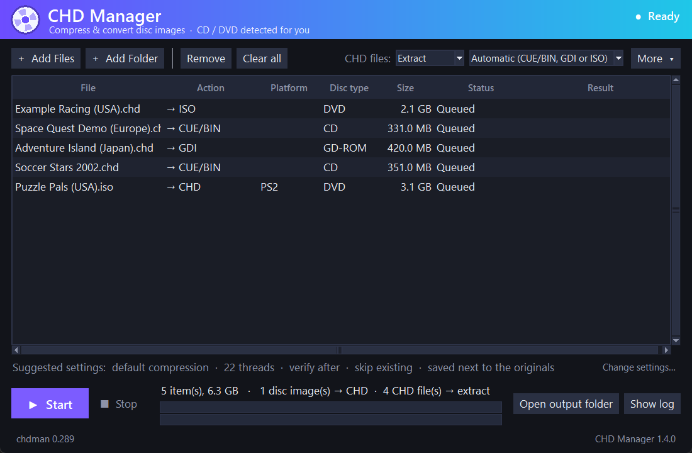
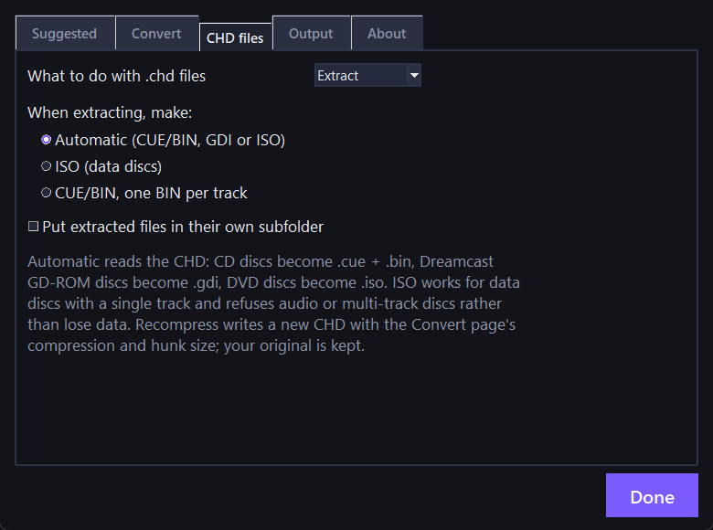

# CHD Manager

A friendly Windows app for turning disc images (`.cue`/`.bin`, `.gdi`, `.iso`) into compressed **CHD** files and back again. It works out whether each disc is a **CD or a DVD** for you, so there is no "which button do I press" guessing, and it picks sensible settings for your PC.

CHD Manager is a front end for `chdman`, the tool from the [MAME](https://github.com/mamedev/mame) project. It is portable: one folder, nothing installed, nothing written outside it.


<details>
<summary>Light theme</summary>


</details>

<details>
<summary>Working with CHD files</summary>





</details>

<details>
<summary>Settings window, About page</summary>


</details>

## Features

- **Drag and drop** files or folders onto the window, or onto the exe itself (or use *Open with*), or use Add Files / Add Folder. Folders are searched recursively.
- **Queue** of files or folders. Loose `.bin` files that already belong to a `.cue` are skipped.
- **CD or DVD, detected automatically.** `.cue`/`.gdi`/`.toc` are CD. An `.iso` is CD if it fits on a CD, DVD if it is larger, and PSP images are DVD. It also looks inside the image to label the platform (PS1, PS2, PSP, Dreamcast, Saturn, Sega CD). Right-click any item to force CD or DVD.
- **You choose what happens to CHD files.** Disc images (`.cue`, `.gdi`, `.iso`, `.toc`) become CHDs. When a CHD is in the list, a **CHD files** choice appears at the top: **Extract** it back to a disc image, **Verify** it, or **Recompress** it with different compression (your original is kept). When extracting you pick the format: **Automatic** (CUE/BIN for CDs, GDI for Dreamcast, ISO for DVDs), **ISO** for data discs, or CUE/BIN with one BIN per track or one single BIN. Automatic reads each CD's track count first: a disc with several tracks (audio plus data) gets one BIN per track, and a one-track disc gets a single BIN, with no setting to remember. Anything that comes out as several files (split CDs, Dreamcast GDI) is put in its own folder named after the disc, so a big batch stays tidy. ISO is only offered when nothing would be lost, so discs with audio, several tracks, or PS1-style audio/video sectors are refused instead of mangled. The Action column always spells out what will happen to each file, you can override a single file by right-clicking it, and a skipped job says why.
- **Suggested settings.** It looks at your PC and your queue and fills in thread count, compression, and so on, with the reason for each. Weak PCs automatically get low-priority mode so Windows stays usable.
- **Safety.** Optional verify after creating each CHD. Optional "send sources to the Recycle Bin", and only after the new CHD passed verification, so your source files are never permanently deleted.
- **Options.** Compression presets or custom codecs, hunk size, threads, skip/overwrite/rename existing files, output folder (with folder structure kept), per-track `.bin` extraction.
- **Progress and log** for every job, an Info window, a summary of the space you saved, and a dark and a light theme.
- **Updates.** The two version buttons at the bottom of the window (chdman on the left, CHD Manager on the right) are also the update buttons: click one to check, and it turns orange when an update is waiting. One click checks MAME's latest chdman and, if you confirm, installs it (checksum-verified, with a backup of the old one). CHD Manager can also update itself from this repo's releases: it checks the SHA-256, test-runs the new version, then swaps it in and restarts. The prompt offers **Update now**, **Remind me next time**, or **Skip this version**, and a small badge stays in the window's header either way.
- **A settings window** (More menu, or *Change settings…*) with the conversion options, output folder, the suggested-settings explanation, and an About page with the version, links, license info, the CHD Manager update controls, and a *Copy diagnostics* button for bug reports (it leaves out your folder paths and user name).
- **A calm layout.** One list of discs, one line saying which settings will be used, and one Start button. The settings window, the log and the less common actions (verify, info, theme, updates) stay out of the way until you want them, and the log opens by itself if something fails. The window also scales sensibly when you resize it.

## Download and use

1. Get the zip from the [Releases](../../releases) page and unzip it anywhere.
2. Run **CHD Manager.exe**.
3. Click **Add Files** or **Add Folder** (or drag them in), glance at the settings line under the list, and press **Start**.

Windows 10/11, 64-bit. Python is not needed. Settings are saved in `chd_manager_settings.json` next to the exe.

**About warnings:** the exe is not code-signed, so Windows SmartScreen may say "unknown publisher" (choose *More info → Run anyway*) and some antivirus programs are suspicious of this kind of packaged Python program. If you would rather not run a binary, [run it from source](#run-from-source) or [build it yourself](#build-the-exe).

## How CD vs DVD is chosen

| Image | Type |
| --- | --- |
| `.cue`, `.gdi`, `.toc`, loose `.bin` | CD (`createcd`) |
| `.iso` up to 737,280,000 bytes (an 80-minute CD) | CD |
| `.iso` larger than that | DVD (`createdvd`) |
| PSP images | DVD |

If a PS2 game on a CD slightly exceeds the size limit, or anything else is detected wrongly, right-click it and force the type.

Many PS2 CHDs you find online are CD-type (made with `createcd`), even for big DVD games. CHD Manager builds DVD-type CHDs for big ISOs. Both are valid CHDs, the DVD-type came out 0.6-2% smaller in testing, and both booted in PCSX2, but check that one game boots before converting a collection.

## Network use

CHD Manager is offline except for the update checks. Each has its own on/off switch (chdman in the settings window's **Output** page, CHD Manager on its **About** page):

- At startup it asks GitHub for the number of the latest MAME release, and for the latest CHD Manager release. It never downloads anything by itself.
- When you confirm a CHD Manager update, it downloads the release zip from this repo (`github.com/Mr-Shizzy/CHD-Manager`), verifies its SHA-256, and only then replaces itself. If you're running the script instead of the exe, it just offers to open the download page.
- When you press the chdman update button and confirm, it downloads the official release from `github.com/mamedev/mame`. Opening that download needs [7-Zip](https://7-zip.org). If it is missing, the app offers to install it with `winget`, and if you decline only the update button stops working.

## Run from source

Needs Python 3 with tkinter (tested with 3.12) and `chdman.exe` from a [MAME release](https://github.com/mamedev/mame/releases) placed next to the script:

```
python CHD_Manager.pyw
```

## Build the exe

Needs Python 3 (tested with 3.12) and 7-Zip.

```
powershell -ExecutionPolicy Bypass -File build.ps1
```

This installs PyInstaller, downloads the latest official chdman (checking its SHA-256), builds `CHD Manager.exe`, and writes the portable folder and a zip to `dist/`. Use `-ChdmanPath` to supply your own chdman instead.

## Testing

Tested on Windows 11 against **42 real discs**: 6 Dreamcast GD-ROM, 3 Dreamcast CD, 16 PS1 and 17 PS2 (7.3 GB of CHDs, 24 GB uncompressed). The test drove the app's own code (folder scan, detection, suggested settings, convert, extract, verify) with chdman 0.289:

| Check | Result |
| --- | --- |
| Verify all 42 existing CHDs | 42 / 42 passed |
| Extract all 42 (to `.cue`/`.bin` and `.gdi`) | 42 / 42 |
| Rebuild all 42 with the default settings | 42 / 42 have the **same data SHA-1 as the original CHD**; file sizes within -5.9% to +0.3% (median 0.0%) |
| Platform label (PS1 / PS2 / Dreamcast) | 42 / 42 |
| DVD path on two real PS2 ISOs (4.4 GB and 1.4 GB) | built as DVD-type CHDs, verified, extracted back to an ISO with the same SHA-1 as the source |
| Playback in emulators (boot and intro, not played through) | **PS2** in PCSX2 nightly 2.9.146: a CD-type CHD, a DVD-type CHD of the same game, and a 4.4 GB DVD-type CHD built by CHD Manager all booted (the DVD-type files log a harmless "Failed to parse CHD TOC" line). **PS1** in DuckStation 0.1.12074: one game rebuilt at six settings (default, none, zlib, LZMA, zstd, doubled hunk) all booted identically, and a 32-track CD-audio disc and an English-patched game behaved exactly like the original CHDs. **Dreamcast** in RetroArch with the Flycast core: one GD-ROM rebuilt at the same six settings, a second GD-ROM, and a CD-type self-boot disc that starts with audio tracks all booted. |
| Many-track discs (32, 11 and 2 tracks), extracted with Automatic (split per track) and rebuilt | identical data; a one-track disc stays one BIN |
| CHD to ISO (new in 1.4) | a CD CHD with Mode 2 raw sectors became a valid 2048-byte-per-sector ISO that PCSX2 booted; a MODE1/2048 CD CHD became an ISO byte-identical to an independently verified one; audio, multi-track, PS1-style Form 2 and GD-ROM discs were refused with a reason and left no files |
| Recompress CHD (new in 1.4) | CD, GD-ROM and DVD CHDs recompressed with the same data checksum; the original is never overwritten |
| Corrupted, truncated and non-CHD files | all flagged as failed, nothing crashed |
| Overwrite / skip / rename, lone `.bin`, "recycle sources after a verified CHD" | behaved as described |

**Compression levels** (7 discs, CD-type, up to 4.4 GB), size relative to the default settings: LZMA-only 100.5%, zlib ("Fast") 108%, zstd 104% and 1.8x slower, doubling the hunk size 95% (0.6% smaller on the big disc, up to 10% on small ones). All of those settings, including zstd, uncompressed and the larger hunk, booted in DuckStation and Flycast. The default is still the right choice for almost everything.

**Threads** (a 286 MB disc): 1 thread 34 s, 4 threads 11 s, 8 threads 5 s, 16 threads 3.9 s, 22 threads 3.8 s. Speed stops improving at around 16. Low-priority mode cost nothing on an idle PC.

**Bugs this testing found, fixed in 1.2.1:** "None" compression plus verify reported a false failure; chdman's real error text was hidden when a job failed; three Dreamcast CD discs that start with audio tracks got no platform label; folders containing `.cdi`/`.pbp` files were skipped silently.

**Not tested:** playing any game through (I only checked that each boots and shows its intro), emulators other than PCSX2, DuckStation and RetroArch/Flycast, other versions of chdman, or other versions of Windows. `.cdi`, `.mds`, `.nrg`, `.ccd` and `.pbp` files aren't supported by chdman, so the app skips them and says so.

## Credits and license

- `chdman` is from the [MAME](https://github.com/mamedev/mame) project and its authors. CHD Manager is not made by, affiliated with, or endorsed by MAME. "MAME" is a registered trademark of Gregory Ember.
- Built with help from Claude (Anthropic); designed and tested by Mr-Shizzy.
- This project includes no games, BIOS files, or other copyrighted game content. Use it only with discs you own.

CHD Manager's own code is under the [0BSD license](LICENSE): do whatever you like with it, no strings attached. Forks and remakes are welcome. The release bundles chdman, Python and Tcl/Tk, whose licenses are in [THIRD_PARTY_NOTICES.txt](THIRD_PARTY_NOTICES.txt).
