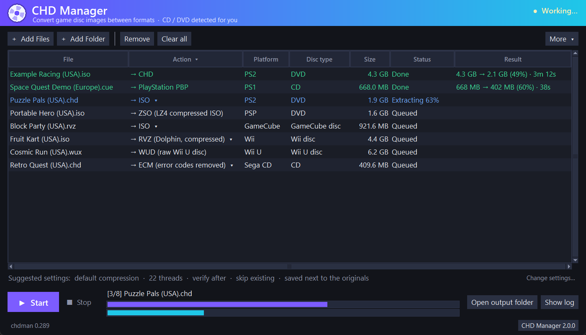
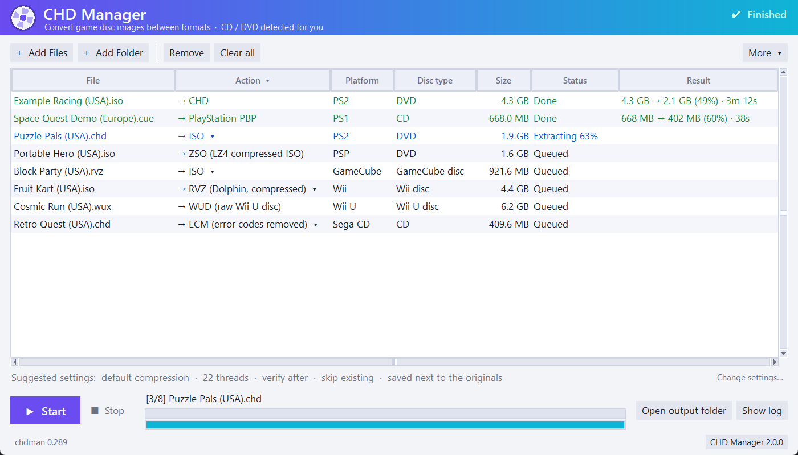
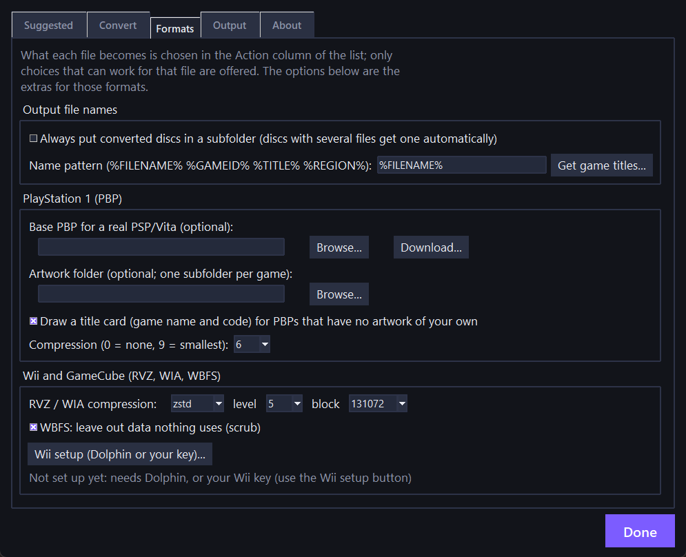
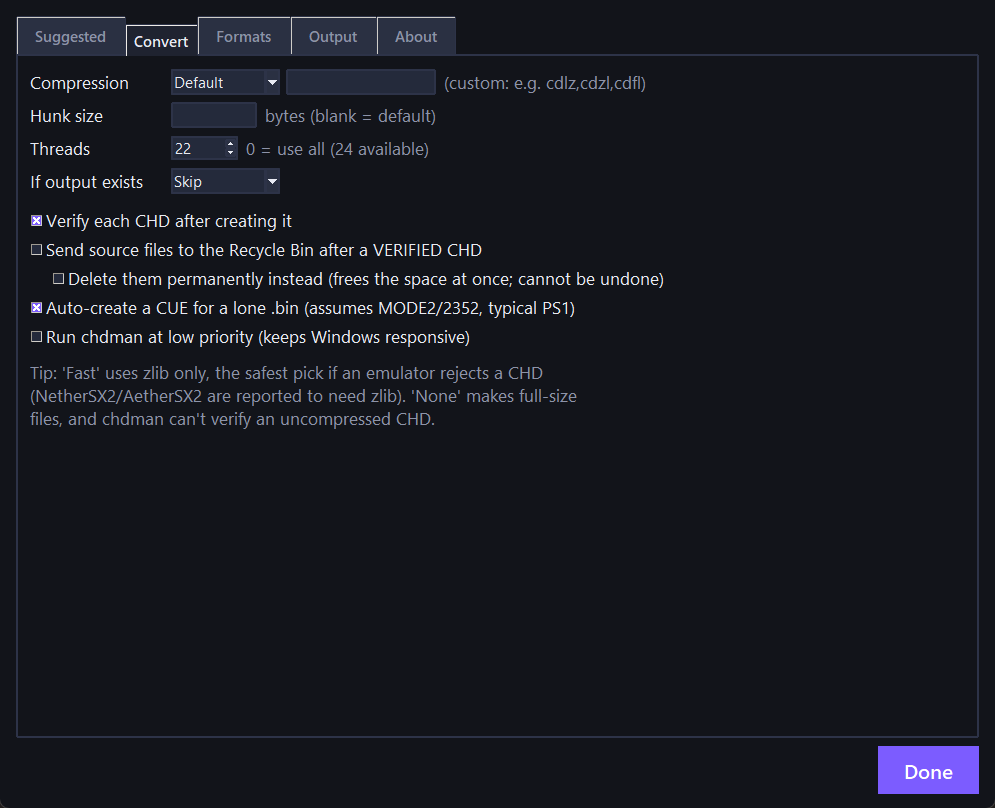
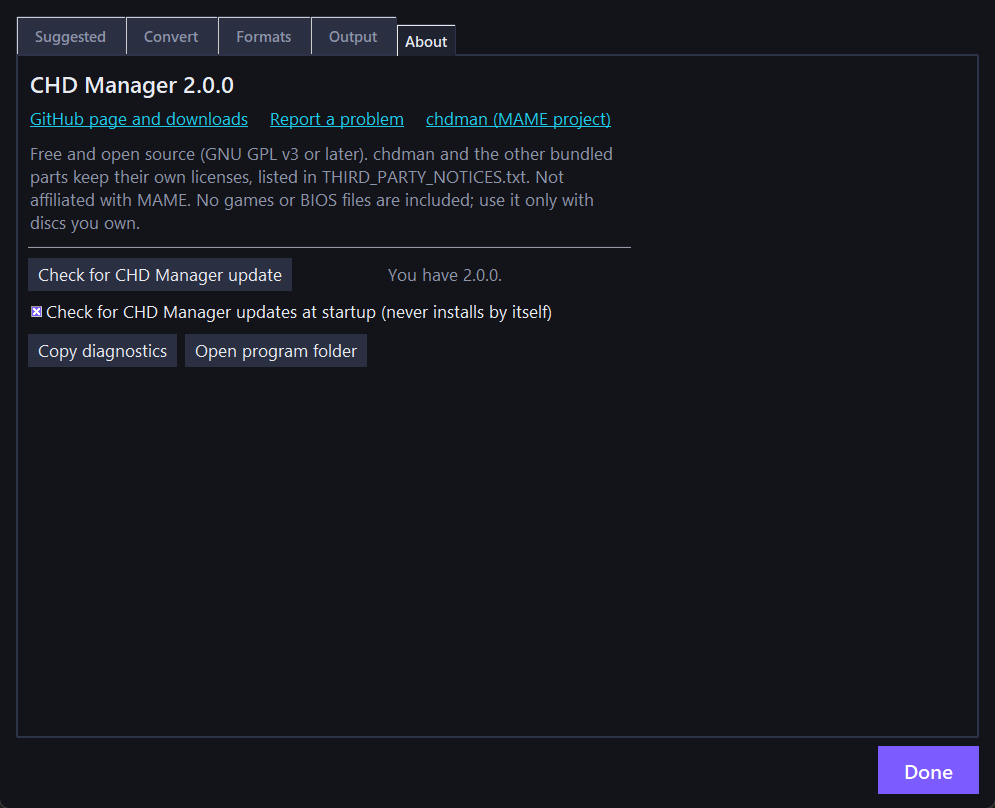

# CHD Manager

A friendly Windows app that converts game disc images from one format to another, and the front end for MAME's `chdman`: **CHD, PBP, CDI, CSO/ZSO, ECM, ISO, CUE/BIN, GDI** for PlayStation, Dreamcast, Saturn, Sega CD and PSP, and **RVZ, WIA, WBFS, GCZ, CISO, WUX/WUD** for GameCube, Wii and Wii U. Add your files, pick what each one should become, and press Start. It works out what each disc is, only offers conversions that can work, checks there is room on the drive before it starts, and verifies what it wrote.

It is portable: one folder, nothing installed. CHD conversions are done by `chdman` from the [MAME](https://github.com/mamedev/mame) project; the other formats are handled by the program's own code.



<details>
<summary>Light theme and settings</summary>









</details>

## What it converts

Each file in the list has an **Action** drop-down; it only offers what can work for that file.

| Format | What it is | Read | Write |
| --- | --- | :-: | :-: |
| **CHD** | MAME's compressed disc format, used by MAME, DuckStation, PCSX2, Flycast, RetroArch and others (CD, DVD and Dreamcast GD-ROM) | yes | yes |
| **CUE/BIN, GDI, ISO** | Plain disc images (one BIN per track or a single BIN; GDI for Dreamcast) | yes | yes |
| **PBP** | PlayStation 1 games for the PSP and Vita (multi-disc too), with optional artwork or a drawn title card | yes | yes |
| **CDI** | DiscJuggler images (including Dreamcast CD-Rs) | yes | yes |
| **MDS/MDF, NRG, CCD/IMG** | Alcohol 120%, Nero and CloneCD images | yes | no |
| **CSO, ZSO** | Compressed PSP/PS2 ISOs (CSO uses deflate, ZSO uses LZ4); `.ciso` PSP files are read too | yes | yes |
| **ECM** | Neill Corlett's format that removes the error-correction data from raw CD images | yes | yes |
| **RVZ, WIA** | Dolphin's compressed GameCube and Wii formats | yes | yes |
| **WBFS** | The Wii backup-manager format (split `.wbf1` files are read too) | yes | yes |
| **GCZ, CISO** | Dolphin's older compressed formats | yes | yes |
| **WUX, WUD** | Wii U disc images (compressed and raw) | yes | yes, in both directions |
| **ZIP, TAR, GZ, 7Z, RAR** | Archives are opened as input (7Z and RAR use 7-Zip) | yes | n/a |

Also: **rebuild a CD's error correction** (Mode 1 and Mode 2 Form 1, so a CUE/BIN with blank EDC/ECC data becomes a full-size, correct image), **extract the artwork from a PBP**, and **title cards** that give a PBP a readable name and code in the PSP menu when you have no artwork of your own.

Wii discs and keys: turning a **Wii** disc into RVZ, WIA or WBFS needs either your own copy of Dolphin (the program just runs its `DolphinTool.exe`) or your own Wii key. This program contains no key and never downloads one; see [Wii and GameCube](#wii-and-gamecube). Everything else, including reading any format and converting GameCube or Wii U discs, needs neither.

## Features

- **Drag and drop** files or folders onto the window or the exe, or use Add Files / Add Folder. Folders are searched recursively.
- **One Action choice per file.** Click the cell to change it, or the *Action* heading to set it for every file that can do it. A skipped job says why.
- **CD or DVD, detected automatically** for CHD, with the platform labelled (PS1, PS2, PSP, Dreamcast, Saturn, Sega CD, GameCube, Wii, Wii U). Right-click to force CD or DVD.
- **Any format to any format it can produce.** Where there is no direct route the program goes through a temporary, uncompressed CHD, so every target is written by the same code whatever the source.
- **Safety.** Optional verify after each conversion (a CHD's SHA-1, or reading the result back and comparing it with the source for the formats that allow it). Optional "send sources to the Recycle Bin", only after a verified result. Optionally delete them permanently instead, which frees the space at once (off by default, with a warning).
- **Disk-space check.** Before each job the program estimates the most space it will use, including temporary files, and refuses it with a plain message when it clearly won't fit, instead of failing halfway and leaving a partial file.
- **Suggested settings.** Looks at your PC and your queue and fills in thread count, compression and so on, with the reason for each.
- **File names** from the game's title, ID or region (`%FILENAME% %GAMEID% %TITLE% %MAINTITLE% %REGION%`), using PlayStation game data or the name stored on a GameCube/Wii disc.
- **Command line** (`chdm`): the same conversions without a window. See [Command line](#command-line).
- **Updates.** The two version buttons at the bottom of the window (chdman on the left, the program on the right) are also the update buttons. Updates are checksum-verified, test-run, and never installed without you confirming.
- **Progress and log** for every job, a summary of the space you saved, a dark and a light theme, and a settings window with an About page and a *Copy diagnostics* button for bug reports (it leaves out your folder paths and user name).

## Download and use

1. Get the zip from the [Releases](../../releases) page and unzip it anywhere.
2. Run **CHD Manager.exe**.
3. Click **Add Files** or **Add Folder** (or drag them in), check the Action column, and press **Start**.

Windows 10/11, 64-bit. Python is not needed. Settings are saved in `chd_manager_settings.json` next to the exe.

**About warnings:** the exe is not code-signed, so Windows SmartScreen may say "unknown publisher" (choose *More info → Run anyway*) and some antivirus programs are suspicious of this kind of packaged Python program. If you would rather not run a binary, [run it from source](#run-from-source) or [build it yourself](#build-the-exe).

## Wii and GameCube

- **GameCube discs** work with no setup in every direction (ISO, RVZ, WIA, GCZ, CISO).
- **Wii discs** can always be read, and written to ISO, GCZ and CISO. To write **RVZ, WIA or WBFS** the program needs one of these (open *Settings, Formats, Wii setup*, or use the prompt at startup):
  1. **Dolphin on your PC.** Show the program where Dolphin is. It runs Dolphin's own `DolphinTool.exe` for those conversions; no key is needed.
  2. **Your own Wii key.** Put it in the `keys` folder next to the program (a text file holding the 32-character key), choose the file, or paste it in the setup window.
- The program does **not include** a Wii key and never fetches one. Without either option those three conversions are simply not offered.
- Wii U discs (`.wux`, `.wud`) need nothing.

## Command line

The `chdm.cmd` launcher in the zip runs the same conversions without a window and passes on the exit code (0 = everything done or skipped, 1 = something failed, 2 = wrong command line):

```
chdm game.cue --to chd -o D:\chd
chdm game.chd --to pbp --level 9 -o D:\psp
chdm D:\roms --to chd --exists overwrite --log convert.txt
chdm game.chd game2.iso --list
chdm --help
```

`--list` shows what each file can become. In `cmd`, run it as `.\chdm` (or put the folder on your PATH). The exe alone returns immediately because it is a windowed program; the launcher is what waits.

## How CD vs DVD is chosen for CHD

| Image | Type |
| --- | --- |
| `.cue`, `.gdi`, `.toc`, loose `.bin` | CD (`createcd`) |
| `.pbp` (PlayStation 1), `.cdi`, `.mds`/`.mdf`, `.nrg`, `.ccd`/`.img`, bare `.img` | CD: unpacked to `.cue`/`.bin` in a temporary folder first, then `createcd` |
| `.iso` up to 737,280,000 bytes (an 80-minute CD) | CD |
| `.iso` larger than that, and PSP images | DVD (`createdvd`) |

If a PS2 game on a CD slightly exceeds the size limit, or anything else is detected wrongly, right-click it and force the type. Many PS2 CHDs you find online are CD-type; this program builds DVD-type CHDs for big ISOs. Both are valid and both booted in PCSX2, but check that one game boots before converting a collection.

## Network use

The program is offline except for the update checks, each with its own on/off switch (chdman on the *Output* page of the settings window, the program on its *About* page):

- At startup it asks GitHub for the latest MAME release number and the latest CHD Manager release. It never downloads anything by itself.
- When you confirm a CHD Manager update it downloads the release zip from this repo, verifies its SHA-256, and only then replaces itself. When you confirm a chdman update it downloads the official release from `github.com/mamedev/mame` (opening it needs [7-Zip](https://7-zip.org); the app can install it with `winget` if you agree).
- Two optional downloads, each only on request and checked against a fixed checksum: the base PBP files for a real PSP (from [iPoPS](https://github.com/julianxhokaxhiu/iPoPS)) and a refreshed game list.

## Run from source

Needs Python 3 with tkinter (tested with 3.12), `chdman.exe` from a [MAME release](https://github.com/mamedev/mame/releases) next to the script, and `pip install zstandard` for RVZ and ZSO:

```
python CHD_Manager.pyw
```

## Build the exe

Needs Python 3 (tested with 3.12) and 7-Zip.

```
powershell -ExecutionPolicy Bypass -File build.ps1
```

This installs PyInstaller and zstandard, downloads the latest official chdman and the game list (checking the SHA-256 of both), builds `CHD Manager.exe`, and writes the portable folder and a zip to `dist/`. Use `-ChdmanPath` to supply your own chdman.

## Testing

Everything below was run on Windows 11 with chdman 0.289. The program's own code is driven by automated test scripts; the sample discs are my own backups.

**CHD, PBP, CDI and image formats (versions 1.x, still passing):** 42 real discs (6 Dreamcast GD-ROM, 3 Dreamcast CD, 16 PS1, 17 PS2) verified, extracted and rebuilt with the same data SHA-1 as the originals; boots in PCSX2 nightly, DuckStation and RetroArch/Flycast. PBP files (including a 2-disc and a 4-disc game) were converted both ways and booted in DuckStation; on a **real PSP** (6.61 ARK-5 custom firmware) a one-disc game made with the downloaded base booted and played, and a 2-disc game booted and switched to disc 2. CDI files for four Dreamcast CD-Rs were read back and compared; three booted in Flycast and the fourth reached its title screen. MDS/MDF, NRG, IMG and CCD images each gave a CHD with the expected data checksum.

**New in 2.0:**

| Check | Result |
| --- | --- |
| Mode 1 error correction (EDC/ECC) | Rebuilt on 43,997 real Sega CD sectors: 0 differences from the originals |
| ECM | Encoded and decoded back to identical images (own encoder/decoder, written from the format description) |
| ZSO (LZ4) | Compressor and decompressor cross-checked against the real `lz4` library, both directions |
| GameCube and Wii: reading | 6 sample RVZ files (zstd and LZMA, GameCube and Wii) and one WBFS were converted to ISO and compared with the output of Dolphin's own `DolphinTool`: byte-identical |
| GameCube and Wii: writing | Our RVZ (zstd and LZMA), WIA, GCZ and CISO files were opened by DolphinTool and gave the same disc; a scrubbed WBFS extracted 59 of 59 identical files |
| Speed | A 4.7 GB Wii disc to RVZ in about 19 s; RVZ back to ISO in about 31-75 s |
| Wii U | A real `.wux` converted to `.wud` and back to `.wux` and held the same disc |
| Disk-space check | Tested with a simulated small drive: a job that cannot fit is refused with a clear message, the next job still runs, nothing partial is left |
| Command line | Checked on a built exe: exit codes 0/1/2, output and redirection |
| Automated suites | About 20 test scripts covering every conversion route; all pass |

**Not tested:**

- Any of the new formats on real hardware or in every emulator: RVZ/WIA/GCZ/CISO/WBFS were checked against Dolphin's tool but not played in Dolphin; ZSO was not tried in PPSSPP or PCSX2; the new title cards were not tried on a real PSP; Wii U output was not tried in Cemu.
- Files made by other programs for some formats: CISO, GCZ, WIA with purge compression, and split WBFS files; ECM files made by other tools; ECM's "Form 2" sector type.
- WBFS shrinking of an unscrubbed disc (the samples were already scrubbed); the Dolphin route for WBFS was only proven on those.
- CISO cannot store a disc's exact size (the last block is always kept).
- Multi-track `.nrg` files, CloneCD files made by CloneCD itself, multi-session images, CDI files in DiscJuggler itself, PBPs on a PSP Go, Vita or PS Classic, discs 3 and later of multi-disc games, and playing any game all the way through.
- Other versions of chdman or Windows.

## Credits and license

- `chdman` is from the [MAME](https://github.com/mamedev/mame) project and its authors. This program is not made by, affiliated with, or endorsed by MAME. "MAME" is a registered trademark of Gregory Ember.
- The GameCube and Wii disc code is a Python port of parts of the [Dolphin](https://github.com/dolphin-emu/dolphin) emulator's DiscIO code (GPL-2.0-or-later), and is the reason this project is GPL. Not affiliated with Dolphin.
- The ECM format and reference tools are by Neill Corlett; ZSO uses the LZ4 block format by Yann Collet; PBP and CDI layouts were worked out with help from [PSXPackager](https://github.com/RupertAvery/PSXPackager) (MIT, RupertAvery), whose `gameInfo.db` game list ships in the zip. The Wii U formats follow the public format descriptions (the [Cemu](https://github.com/cemu-project/Cemu) source was consulted as a reference).
- The optional base PBP files for real-PSP use are downloaded on request from [iPoPS](https://github.com/julianxhokaxhiu/iPoPS) (MIT); they are not part of this project.
- Built with help from Claude (Anthropic); designed and tested by Mr-Shizzy.
- This project includes no games, BIOS files, Wii keys or other copyrighted game content. Use it only with discs you own.

CHD Manager is free software under the [GNU General Public License, version 3 or (at your option) any later version](LICENSE). The release also bundles chdman, Python, Tcl/Tk and zstandard, whose licenses are in [THIRD_PARTY_NOTICES.txt](THIRD_PARTY_NOTICES.txt).
